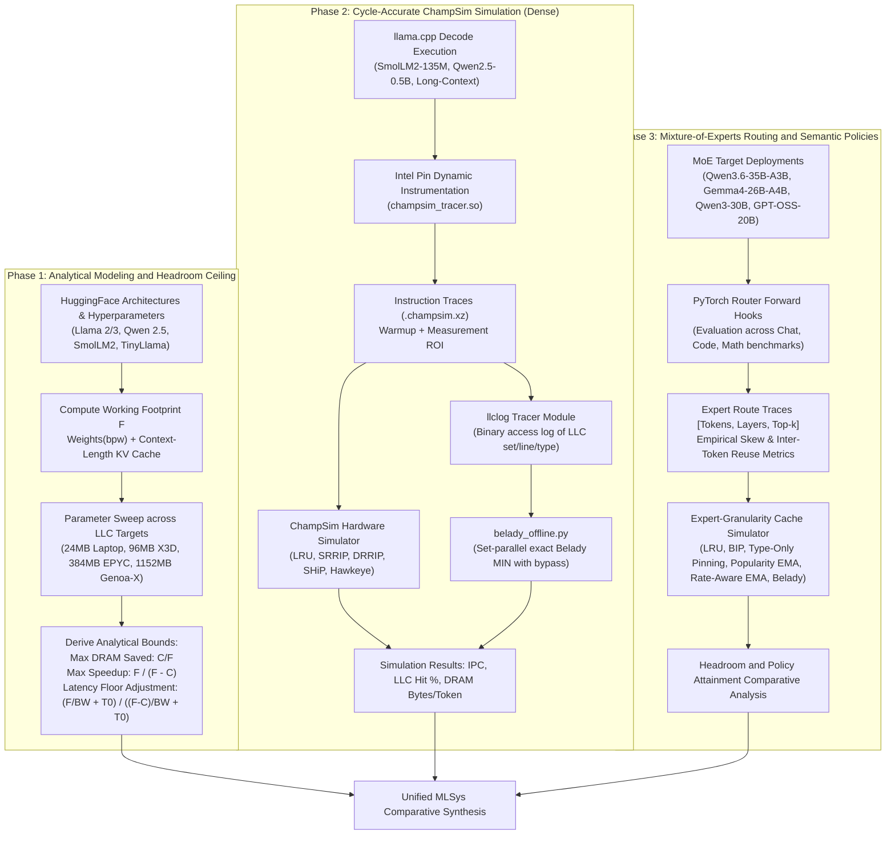
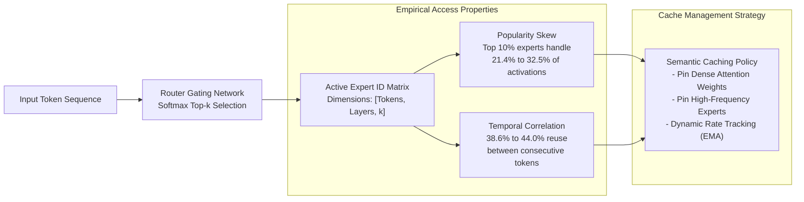

# MLSys-CPU-CACHES: LLC Replacement-Policy Headroom for LLM Inference on CPUs

Targeting MLSys '27: Rigorous quantification and empirical analysis of cache replacement-policy headroom during Large Language Model (LLM) auto-regressive decoding on Central Processing Units (CPUs), analyzing both dense transformer architectures and Mixture-of-Experts (MoE) workloads across varying Last-Level Cache (LLC) capacities.

---

## Executive Summary and Research Question

When executing Large Language Model auto-regressive generation on modern CPU architectures (using engines such as `llama.cpp`), every generated decode token triggers a memory sweep across active model parameters. Under dense inference, the entire parameter set—plus dynamic Key-Value (KV) cache entries and activation tensors—must be streamed through the CPU memory hierarchy once per token. 

Because the working footprint per decode step $F$ substantially exceeds typical CPU Last-Level Cache (L3/LLC) capacity $C$ ($F \gg C$), standard recency-based eviction policies such as Least Recently Used (LRU) fail catastrophically. The access pattern is fundamentally cyclic: by the time an address is re-referenced in the subsequent decode token, LRU has already evicted it to make space for intermediate layers. Consequently, LRU suffers near-zero cache hit rates and constant memory thrashing.

This investigation centers on three primary research questions:

1. **Theoretical Ceiling**: Given a cyclic access stream where $F > C$, what is the mathematically optimal upper bound on cache hit rate and DRAM bandwidth reduction that an offline oracle replacement policy (Belady's MIN) can deliver?
2. **Dense Model Attainability**: How close do practical hardware-level cache replacement policies (SRRIP, DRRIP, SHiP, Hawkeye) approach the Belady ceiling on actual hardware instruction traces generated from quantized CPU inference engines?
3. **Mixture-of-Experts (MoE) Opportunity**: In sparse architectures where routing functions introduce severe skew and temporal correlation across expert activations, can software-directed semantic hints and rate-aware caching unlock headroom that hardware-blind policies leave behind?

---

## Methodological Architecture and Pipeline

The investigative workflow combines analytical modeling, cycle-accurate microarchitectural simulation on execution traces, and trace-driven expert-level simulation across diverse workloads.



---

## Phase 1: Analytical Headroom and Limits (Dense Decoding)

Let $F$ denote the total bytes streamed during the decode pass of a single token, and $C$ denote the usable capacity of the processor's Last-Level Cache. 

$$F = W_{\text{weights}} + S_{\text{kv}} \cdot \text{ctx}$$

Where:
- $W_{\text{weights}} = \left[ L \cdot (2 h \cdot H \cdot d + 2 h \cdot kv \cdot d + 3 h \cdot \text{inter}) + V \cdot h \right] \cdot \frac{\text{bpw}}{8}$
- $S_{\text{kv}} = L \cdot 2 \cdot kv \cdot d \cdot \text{sizeof(FP16)}$

When $F > C$, an optimal cache replacement algorithm preserves exactly $C$ bytes of data across consecutive token iterations, requiring only $F - C$ bytes to be fetched from off-chip DRAM. Conversely, LRU thrashing yields zero sustained hits on cyclic iterations.

- **Theoretical Maximum DRAM Traffic Reduction**:
  $$\text{DRAM Savings Ceiling} = \frac{C}{F}$$

- **Bandwidth-Bound Speedup Factor**:
  $$\text{Speedup}_{\text{ideal}} = \frac{F}{F - C}$$

- **Latency-Floor Constrained Speedup**:
  Empirical benchmarking reveals a baseline compute overhead per token $T_0 \approx 0.76\text{ ms}$ and effective DRAM bandwidth $BW \approx 53.1\text{ GB/s}$ on laptop platforms. The realistic speedup ceiling is bounded by:
  $$\text{Speedup}_{\text{bounded}} = \frac{\frac{F}{BW} + T_0}{\frac{F - C}{BW} + T_0}$$

### Architectural Sweep Configurations

The analytical model surveys combinations across:
- **Models**: SmolLM2-135M, SmolLM2-360M, Qwen2.5-0.5B, TinyLlama-1.1B, Llama-3.2-1B, Qwen2.5-1.5B, Llama-3.2-3B, Llama-2-7B, Llama-3.1-8B.
- **Quantization Precisions**: FP16 (16.0 bpw), Q8_0 (8.5 bpw), Q4_0 (4.5 bpw).
- **Context Windows**: 256, 1024, and 4096 tokens.
- **Microarchitectures**: Intel Core i7-13650HX (24MB L3), AMD Ryzen 7 7800X3D (96MB 3D V-Cache), AMD EPYC Genoa (384MB L3), AMD EPYC Genoa-X (1152MB 3D V-Cache).

### Characterization of the Cache Headroom Frontier

The analytical results reveal that policy-driven benefits follow a distinct distribution dictated by the footprint-to-cache ratio $F/C$:

1. **Sub-Capacity Regime ($F/C \le 1.0$)**: All active parameters reside permanently in cache. LRU achieves full hit rates; replacement optimization yields zero incremental benefit.
2. **High-Headroom Sweet Spot ($1.0 < F/C \le 4.0$)**: The cache holds between 25% and 90% of the active footprint. Replacement policy choices dictate system throughput. For example, SmolLM2-135M at Q4_0 ($F \approx 94.6\text{ MB}$) on a 24MB LLC ($F/C \approx 3.94$) yields a theoretical DRAM reduction of 25.4% and an ideal speedup of 1.34x. On server caches (EPYC Genoa-X, 1152MB), models like Llama-3.2-1B Q8_0 ($F \approx 1284\text{ MB}$, $F/C \approx 1.11$) achieve up to 89.7% traffic reduction.
3. **Memory-Dominated Regime ($F/C > 10.0$)**: The cache capacity represents a negligible fraction of the working set (e.g., Llama-3.1-8B on a 24MB laptop cache). Even optimal replacement cannot reduce DRAM traffic by more than 1-3%.

---

## Phase 2: Microarchitectural Cycle-Accurate Evaluation

To establish whether physical microarchitectures can harvest the theoretical ceiling, dynamic instruction traces were gathered from real CPU inference executions of `llama.cpp` using Intel Pin tools, feeding cycle-level ChampSim simulations.

```mermaid
sequenceDiagram
    autonumber
    participant Engine as llama.cpp Decode Engine
    participant Tracer as Intel Pin (champsim_tracer.so)
    participant Sim as ChampSim Hardware Simulator
    participant Logger as llclog Replacement Module
    participant Belady as Offline Set-Replay (belady_offline.py)

    Engine->>Tracer: Generates decode loop memory instructions
    Tracer->>Sim: Streams instructions into ROI (.champsim.xz)
    Sim->>Sim: Evaluates replacement policies (LRU, SRRIP, DRRIP, SHiP, Hawkeye)
    Sim->>Logger: Dispatches cache accesses to custom llclog module
    Logger-->>Logger: Serializes binary tuples: (line_addr, set_index, access_type)
    Logger->>Belady: Streams binary records for post-processing
    Belady->>Belady: Constructs next-use arrays via set-grouped reverse index
    Belady-->>Belady: Replays exact Belady MIN policy with line bypassing
    Belady->>Sim: Validates LRU trace parity; computes Belady optimal ceiling
```

### Replacement Policies Implemented and Tested

1. **Least Recently Used (LRU)**: Baseline policy maintaining strict recency ordering.
2. **Static RRIP (SRRIP)**: Re-reference Interval Prediction using 2-bit or 3-bit RRPV values. Incoming cache lines insert with a distant re-reference prediction ($2^M - 2$), preventing scan lines from polluting the cache.
3. **Dynamic RRIP (DRRIP)**: Uses set dueling with Dedicated Set Monitors (DSMs) to dynamically choose between SRRIP and Bimodal RRIP (BRRIP).
4. **Signature-based Hit Predictor (SHiP)**: Indexes past re-reference outcomes by instruction pointer (PC) signatures to modulate insertion depth.
5. **Hawkeye (Jain & Lin, ISCA 2016)**: Implemented directly in ChampSim (`hawkeye.cc`, `hawkeye.h`). Utilizes an OPTgen hardware model on 64 sampled cache sets to supervise and train a PC-indexed perceptron/counter table. Cache-friendly lines insert at RRPV 0; cache-averse lines insert at maximum RRPV.
6. **Belady MIN Oracle Replay (`belady_offline.py`)**: Computes optimal set-associative replacement using lookahead next-use indexing on binary logs produced by `llclog.cc`. Guarantees mathematical upper bounds on cache hits for the exact memory stream.

### Cycle-Accurate Empirical Results

Hardware metrics extracted across 12-way associative cache configurations:

| Workload Configuration | LLC Size | Replacement Policy | IPC | IPC Delta vs LRU | LLC Load Hit Rate (%) | DRAM Traffic (MB/tok) | Belady Hit Ceiling (%) | Attainment of Belady (%) |
|---|---|---|---|---|---|---|---|---|
| **SmolLM2-135M Q4 (Short Ctx)** | 24 MB | LRU | 0.3951 | Baseline | 2.57% | 86.9 MB | 28.67% | 8.9% |
| SmolLM2-135M Q4 (Short Ctx) | 24 MB | **SRRIP** | **0.4996** | **+26.4%** | **26.40%** | **65.7 MB** | 28.67% | **92.1%** |
| SmolLM2-135M Q4 (Short Ctx) | 24 MB | DRRIP | 0.4636 | +17.3% | 22.75% | 68.9 MB | 28.67% | 79.4% |
| SmolLM2-135M Q4 (Short Ctx) | 24 MB | SHiP | 0.4997 | +26.5% | 26.28% | 65.8 MB | 28.67% | 91.7% |
| SmolLM2-135M Q4 (Short Ctx) | 24 MB | Hawkeye | 0.4559 | +15.4% | 21.33% | 70.2 MB | 28.67% | 74.4% |
| **SmolLM2-135M Q4 (Short Ctx)** | 48 MB | LRU | 0.3854 | Baseline | 3.42% | 86.2 MB | 55.68% | 6.1% |
| SmolLM2-135M Q4 (Short Ctx) | 48 MB | **SRRIP** | **0.5965** | **+54.8%** | **51.24%** | **43.5 MB** | 55.68% | **92.0%** |
| **SmolLM2-135M Q4 (Short Ctx)** | 96 MB | LRU | 0.6303 | Baseline | 59.32% | 36.3 MB | 100.0% | 59.3% |
| SmolLM2-135M Q4 (Short Ctx) | 96 MB | **SRRIP** | **0.9356** | **+48.4%** | **89.44%** | **9.4 MB** | 100.0% | **89.4%** |
| **Qwen2.5-0.5B Q4 (Short Ctx)** | 24 MB | LRU | 0.3660 | Baseline | 1.50% | 331.7 MB | 9.04% | 16.6% |
| Qwen2.5-0.5B Q4 (Short Ctx) | 24 MB | **SRRIP** | **0.4178** | **+14.2%** | **8.13%** | **309.4 MB** | 9.04% | **89.9%** |
| Qwen2.5-0.5B Q4 (Short Ctx) | 24 MB | SHiP | 0.4236 | +15.7% | 8.36% | 308.6 MB | 9.04% | 92.5% |
| Qwen2.5-0.5B Q4 (Short Ctx) | 24 MB | Hawkeye | 0.3841 | +4.9% | 7.30% | 312.2 MB | 9.04% | 80.8% |
| **SmolLM2-135M Q4 (Long Ctx ~1035)** | 24 MB | LRU | 0.5205 | Baseline | 4.43% | 105.6 MB | 25.85% | 17.1% |
| SmolLM2-135M Q4 (Long Ctx ~1035) | 24 MB | **SRRIP** | **0.6083** | **+16.9%** | **23.77%** | **84.2 MB** | 25.85% | **91.9%** |
| SmolLM2-135M Q4 (Long Ctx ~1035) | 24 MB | Hawkeye | 0.5816 | +11.7% | 20.26% | 88.1 MB | 25.85% | 78.4% |

### Key Findings for Dense Architectures

1. **SRRIP Near-Optimality**: Across all evaluated dense workloads, SRRIP captures **90% to 92.5% of Belady's theoretical ceiling**. Because dense decoding consists of a uniform cyclical sweep, static re-reference interval prediction successfully preserves a working fraction of the footprint, yielding speedups up to **+54.8% IPC**.
2. **Hawkeye Underperformance**: Hawkeye achieves only 74% to 81% of Belady. Hawkeye depends on instruction-pointer (PC) correlations. In optimized linear matrix-vector kernels (e.g., GGML/llama.cpp GEMV), identical load PCs iterate across hundreds of megabytes of weight arrays. The program counter contains zero discriminative entropy regarding which lines will be reused, diluting Hawkeye's training.

---

## Phase 3: Mixture-of-Experts Routing and Semantic Policies

Mixture-of-Experts (MoE) architectures introduce conditional computation: each token dynamically routes to a subset ($k$) of available experts ($E$) across feed-forward layers. This creates non-uniform memory access dynamics that differ fundamentally from dense models.



### MoE Structural Profiles

Traces gathered over Chat, Coding, and Mathematical problem sets:

| Model Architecture | Layer Count | Experts per Layer ($E$) | Active Experts ($k$) | Expert Size (MB) | Top 10% Volume Share | Consecutive Token Reuse | Uniform Baseline Reuse |
|---|---|---|---|---|---|---|---|
| **Qwen3.6-35B-A3B** | 40 | 256 | 8 | 1.69 MB | 26.2% | 38.6% | 3.1% |
| **Gemma4-26B-A4B** | 30 | 128 | 8 | 3.19 MB | 32.5% | 44.0% | 6.2% |
| **Qwen3-30B-A3B** | 48 | 128 | 8 | 2.53 MB | 21.4% | 43.1% | 6.2% |
| **GPT-OSS-20B** | 24 | 32 | 4 | 13.35 MB | 21.6% | 43.9% | 12.5% |

### MoE Policy Formulations

1. **Bimodal Insertion Policy (BIP)**: Popularity-blind scan resistance; inserts the vast majority of items at the LRU position with periodic MRU promotion. Represents the hardware baseline (analogous to SRRIP).
2. **Type-Only Prioritization**: Software hints identify object classes. Dense attention and projection weights (accessed universally every token) receive protected cache allocation, while MoE experts compete in an LRU region.
3. **Popularity-Aware Partitioning**: Uses exponential moving average (EMA) frequency counters to identify and pin the hottest expert weights within a dedicated cache segment, allocating remaining capacity to a BIP pool.
4. **Rate-Aware Allocation (`rate_policy.py`)**: Continuously estimates access rate per byte for each parameter block using an EMA decaying filter:
   $$\text{Rate}_t(x) = \text{Rate}_{t-1}(x) \cdot 2^{-\frac{1}{\tau}} + (1 - 2^{-\frac{1}{\tau}}) \cdot \mathbb{I}(x \in \text{Token}_t)$$
   Sorts parameter blocks by expected hits per byte and fills the cache greedily in order of rank.

### Comparative Policy Attainment on MoE Traces

Hit rates evaluated as a percentage of the offline optimal Belady MIN ceiling:

| Model Architecture | LLC Capacity | Hardware BIP Attainment (%) | Type-Only Attainment (%) | Popularity-Aware Attainment (%) | Rate-Aware (EMA $\tau=16$) Attainment (%) |
|---|---|---|---|---|---|
| **Qwen3.6-35B-A3B** | 96 MB | 39.0% | 98.2% | 99.4% | **99.7%** |
| Qwen3.6-35B-A3B | 384 MB | 33.9% | 100.0% | 100.0% | **100.0%** |
| Qwen3.6-35B-A3B | 1152 MB | 94.6% | 95.1% | 95.6% | **96.8%** |
| **Gemma4-26B-A4B** | 96 MB | 17.5% | 90.0% | 98.2% | **99.1%** |
| Gemma4-26B-A4B | 384 MB | 78.0% | 100.3% | 100.2% | **100.3%** |
| Gemma4-26B-A4B | 1152 MB | 87.5% | 78.5% | 92.0% | **93.5%** |
| **Qwen3-30B-A3B** | 96 MB | 42.8% | 97.3% | 99.3% | **99.7%** |
| Qwen3-30B-A3B | 384 MB | 68.4% | 99.4% | 99.8% | **100.0%** |
| Qwen3-30B-A3B | 1152 MB | 80.3% | 80.4% | 81.5% | **84.9%** |
| **GPT-OSS-20B** | 96 MB | 30.8% | 100.0% | 99.9% | **100.0%** |
| GPT-OSS-20B | 384 MB | 16.9% | 89.7% | 97.3% | **97.8%** |
| GPT-OSS-20B | 1152 MB | 79.6% | 79.7% | 82.9% | **85.0%** |

### Key Findings for Sparse MoE Architectures

1. **Hardware-Blind Policies Collapse on MoE**: While SRRIP/BIP captures over 90% of the ceiling on dense models, it collapses to **17.5% to 68.4%** on MoE models under realistic cache regimes (96MB to 384MB). Hardware policies treat all memory lines symmetrically and fail to recognize expert skew.
2. **Semantic Distinction Provides the Primary Boost**: Distinguishing dense attention tensors from expert blocks (Type-Only) closes the vast majority of the headroom gap, lifting attainment from ~30% to **90-98%**.
3. **Dynamic Rate Estimation Secures the Ceiling**: The causal, online Rate-Aware policy with $\tau=16$ tokens achieves **93.5% to 100.0% of the Belady ceiling**, proving that software-managed or hint-directed cache policies can optimize MoE CPU decoding.

---

## Synthesis and Takeaways for MLSys '27

```
Dense LLM Decoding:
    Memory Pattern:   Deterministic cyclic sweep of uniform weight blocks
    Bottleneck:       LRU thrashing due to working set F > LLC capacity C
    Solution:         Standard hardware scan resistance (SRRIP / SHiP)
    Attainment:       Captures 90-92% of Belady ceiling; +15% to +55% IPC gain

Mixture-of-Experts (MoE) Decoding:
    Memory Pattern:   Deterministic dense attention + highly skewed, autocorrelated expert activations
    Bottleneck:       Hardware scan-resistance is popularity-blind; evicts recurring dense parameters
    Solution:         Software-level hints or semantic cache partitioning (Rate-Aware / Type-Aware)
    Attainment:       BIP achieves only 17-68% of Belady; Semantic/Rate-Aware policies reach 94-100%
```

---

## Repository Artifacts and Directory Guide

- `ceiling_model.py`: Phase 1 analytical ceiling evaluation notebook (Marimo reactive framework).
- `ceiling_model_laptop_updated_run.py`: Phase 1 analytical engine with calibrated memory bandwidth floors ($BW=53.1\text{ GB/s}$, $T_0=0.76\text{ ms}$).
- `hawkeye.cc`, `hawkeye.h`: Custom ChampSim replacement policy module implementing the Hawkeye predictor.
- `llclog.cc`, `llclog.h`: ChampSim replacement module instrumenting and serializing physical LLC access logs.
- `belady_offline.py`: High-performance Python set-parallel replay script computing exact Belady MIN hit metrics with optional line bypass.
- `research.sh`: Complete orchestration automation script for Linux/WSL environments (setup, build, trace, run, and collect).
- `moe_routing.py`: Phase 3 MoE routing collection, expert skew quantification, and cache simulation pipeline.
- `rate_policy.py`: Causal online Rate-Aware cache replacement implementation using exponential decay.
- `dense_results.csv`: Complete ChampSim simulation results across models, cache capacities, and replacement policies.
- `moe_policy_comparison.csv`: Headroom attainment comparison across all MoE models and cache scales.
- `ceiling_model_results_zip/`: Analytical sweep outputs, tabular summaries, and figures.
- `ceiling_model_results__newlaptoprunzip/`: Analytical sweep outputs with latency floor adjustments.
- `moe run results/`: Route tensors (.npz), skew distributions, and cumulative frequency plots.
- `results_baselines/`, `results_day2/`, `results_step1/`: ChampSim execution outputs, trace logs, and Belady replay logs.

---

## Reproduction and Execution Instructions

### 1. Analytical Ceiling Computation
```bash
pip install marimo pandas matplotlib numpy
python -m marimo run ceiling_model.py
# Or to evaluate with calibrated latency floor:
python -m marimo run ceiling_model_laptop_updated_run.py
```

### 2. ChampSim Trace Generation and Cycle Simulation
Prerequisites: Linux environment (Ubuntu 22.04+ or WSL2), GCC 11+, Intel Pin 3.22+, ChampSim repository.
```bash
# Setup directories, download model weights, build prompt suites
bash research.sh setup

# Compile ChampSim binaries for all cache/policy configurations
bash research.sh build

# Launch background simulation jobs across models
bash research.sh launch

# Check simulation and trace execution status
bash research.sh status

# Package output logs and summary metrics
bash research.sh collect
```

### 3. MoE Route Collection and Trace Simulation
Prerequisites: Python 3.10+, PyTorch with CUDA acceleration, HuggingFace credentials (`HF_TOKEN`).
```bash
pip install marimo torch transformers accelerate numpy pandas matplotlib
python -m marimo run moe_routing.py
```
